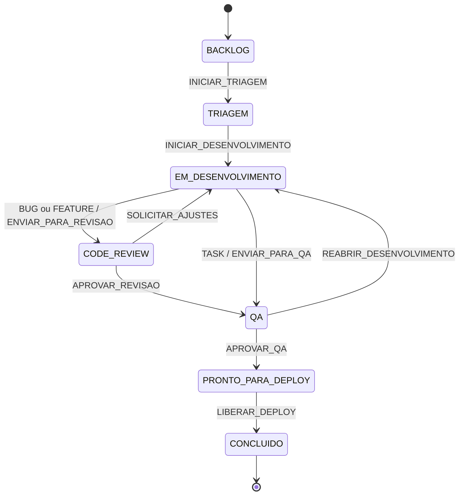
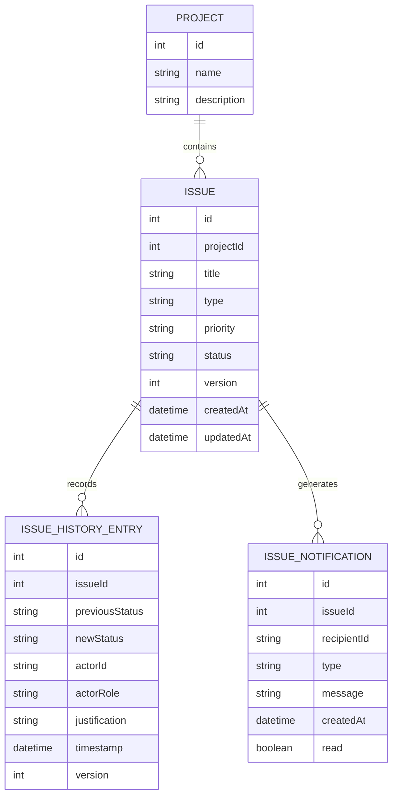

# IssueFlow — Bug Tracker / Issue Tracker

Aplicação acadêmica para organizar bugs, funcionalidades e tarefas, com fluxo de trabalho controlado, regras por tipo de issue, histórico de auditoria, concorrência otimista, SLA e notificações por eventos.

## Tecnologias

- **Frontend:** Next.js 15, React 19, TypeScript e Tailwind CSS.
- **Backend:** NestJS 11, TypeScript e API REST.
- **Runtime validado:** Node.js 24.
- **Banco de dados:** PostgreSQL 18, acessado pelo Prisma ORM 7.10.0; o schema é configurado pela variável `DATABASE_URL`.
- **Frontend:** usa `localStorage` como cache/contingência visual; a persistência principal das issues fica no PostgreSQL.

## Identidade visual

O projeto utiliza o logotipo vetorial **IssueFlow**, localizado em `ppw_client/public/issueflow-logo.svg`, e seu favicon em `ppw_client/public/favicon.svg`. O símbolo representa caminhos/etapas conectadas do fluxo de uma issue.

## Como executar localmente

### Pré-requisitos

- Node.js 24 e npm.
- Git para clonar o repositório.
- Acesso ao PostgreSQL do ambiente (na infraestrutura do IFSP, conectar antes a Forcepoint VPN).

### Windows

1. Clone o repositório.
2. Abra a pasta do projeto.
3. Execute `iniciar-ambiente.bat`.
4. Selecione a opção **3 — Iniciar BACKEND + FRONTEND**.

O script usa caminhos relativos à pasta do repositório. Ele aceita Node.js instalado no sistema ou a distribuição portátil `node-v24.21.0-win-x64` colocada na raiz do projeto.

### Linux, macOS ou execução manual

Terminal 1 — backend:

```bash
cd ppw_server
npm ci
# Crie .env a partir de .env.example e informe host, porta, banco,
# usuário, senha e schema liberados para sua conta.
npm run prisma:generate
npm run prisma:migrate:deploy
npm run prisma:seed
npm run start:dev
```

A configuração `DATABASE_URL` deve apontar para um schema no qual o usuário tenha permissões `USAGE` e `CREATE`. Não use o schema `public` se sua conta não tiver autorização. Consulte `ppw_server/DATABASE.md` para os detalhes.

Terminal 2 — frontend:

```bash
cd ppw_client
npm ci
npm run dev
```

Endereços locais:

- Frontend: http://localhost:3000
- API: http://localhost:8000

A variável `NEXT_PUBLIC_API_URL` pode apontar o frontend para outra URL da API. No backend, `PORT` define a porta HTTP e `CORS_ORIGINS` aceita uma lista de origens separadas por vírgula.

### Verificações

No backend:

```bash
npm run build
npm run lint
npm test -- --runInBand
```

No frontend:

```bash
npm run lint
npx tsc --noEmit
npm run build
```

O workflow de GitHub Actions executa essas verificações nos dois projetos.

## Organização do repositório

```text
ppw_client/
  public/                 # Logo e favicon SVG
  src/app/                # Dashboard, issues, projetos e notificações
  src/components/         # Layout e componentes reutilizáveis
  src/lib/                # API HTTP e cache local
  src/types/              # Contratos TypeScript
ppw_server/
  src/issues/domain/      # Issue, estados, eventos, auditoria e SLA
  src/issues/application/ # Casos de uso, portas, State e Observer
  src/issues/infrastructure/ # Adaptadores Prisma para issues, auditoria e notificações
  src/projects/           # Consulta de projetos via Prisma
  prisma/                 # Schema, migrações e seed
  src/database/           # Configuração compartilhada do Prisma
docs/
  implementation-audit.md
  ai-decisions.md
AI-LOG.md
```

## Máquina de estados

O status não pode ser alterado pelo `PATCH /issues/:id`. A mudança exige uma ação específica em `POST /issues/:id/transitions`, com a versão atual no cabeçalho `If-Match`.



### Regras por tipo

O tipo é definido na criação e permanece imutável. Isso impede que uma issue altere sua categoria no meio do fluxo para contornar uma etapa obrigatória, como o Code Review de BUGs e FEATUREs.

| Tipo | Fluxo | Regra específica |

| --- | --- | --- |
| BUG | Triagem → Desenvolvimento → Code Review → QA → Deploy | Revisão de código obrigatória |
| FEATURE | Triagem → Desenvolvimento → Code Review → QA → Deploy | Exige critérios de aceite com pelo menos 20 caracteres antes do desenvolvimento |
| TASK | Triagem → Desenvolvimento → QA → Deploy | Não passa por Code Review |

### Permissões por ação

| Ação | Perfis autorizados |
| --- | --- |
| Iniciar triagem | TRIAGER, ADMIN |
| Iniciar desenvolvimento | DEVELOPER, ADMIN |
| Enviar BUG/FEATURE para revisão | DEVELOPER, ADMIN |
| Solicitar ajustes / aprovar revisão | REVIEWER, ADMIN |
| Reabrir desenvolvimento após QA | QA, ADMIN |
| Enviar TASK para QA | DEVELOPER, ADMIN |
| Aprovar QA | QA, ADMIN |
| Liberar deploy | RELEASE_MANAGER, ADMIN |

O backend valida novamente a ação, o estado, o perfil e as guardas. **Limite conhecido:** o perfil e o identificador do autor ainda são fornecidos pelo cliente para demonstração; não há autenticação. Portanto, este RBAC demonstra as regras de negócio, mas ainda não é uma fronteira de segurança confiável.

## Modelo conceitual de dados

O diagrama representa as relações persistidas no PostgreSQL. O schema Prisma em `ppw_server/prisma/schema.prisma` é a referência do modelo físico.



## Princípios SOLID aplicados

- **SRP:** casos de uso orquestram; políticas definem transições; guardas validam pré-condições; repositórios cuidam de armazenamento; o Observer trata notificações.
- **OCP:** o caso de uso depende da interface `IssueTransitionPolicy`; novas estratégias podem ser registradas no `IssueTransitionPolicyRegistry` sem inserir condicionais por tipo no fluxo de aplicação.
- **LSP:** `BugTransitionPolicy`, `FeatureTransitionPolicy` e `TaskTransitionPolicy` cumprem o mesmo contrato e podem ser usadas pelo caso de uso sem depender de suas classes concretas.

## Auditoria, concorrência e rollback

- Toda transição bem-sucedida gera um registro append-only com issue, ação, estado anterior/novo, autor, perfil, justificativa, timestamp e versão.
- A atualização do status e a inclusão do histórico são executadas dentro da mesma transação interativa do Prisma (`$transaction`). Se a gravação da auditoria falhar, a transação é revertida pelo PostgreSQL. O histórico também é protegido por trigger contra UPDATE e DELETE.
- Edições e transições exigem `If-Match`. Cabeçalho ausente resulta em **428**; versão desatualizada resulta em **409**.
- Transição incompatível com o estado resulta em **422**; perfil sem permissão resulta em **403**.
- O teste de concorrência disputa uma edição comum e uma transição usando a mesma versão e confirma que só uma operação é aceita.

**Concorrência:** a atualização usa comparação atômica da versão (`id` + `version`) no banco. O histórico e a mudança de status são persistidos na mesma transação ACID. Os testes unitários cobrem as regras e o fluxo local; a conexão institucional também foi validada manualmente criando, consultando e transitando uma issue.

## SLA por prioridade

A contagem começa em `createdAt` e termina na transição para `CONCLUIDO`.

| Prioridade | Prazo de referência |
| --- | ---: |
| CRITICA | 4 horas |
| ALTA | 8 horas |
| MEDIA | 72 horas |
| BAIXA | 168 horas |

A issue é classificada como **em risco** ao consumir 80% do prazo e **vencida** ao ultrapassar o limite. Conclusões são classificadas como dentro ou fora do prazo. Esses valores são parâmetros acadêmicos configuráveis do projeto.

## Eventos, Observer e menções

Os casos de uso publicam eventos de criação, edição e transição. O `IssueEventBus` notifica observadores inscritos; o `IssueNotificationObserver` converte eventos em notificações sem colocar regras de notificação dentro da FSM.

- Menções são reconhecidas no título, descrição e critérios de aceite com a sintaxe `@usuario`.
- Uma nova atribuição gera notificação ao novo responsável.
- Uma transição gera notificação ao responsável atual, exceto quando ele próprio executa a ação.
- A central de notificações fica na rota `/notificacoes`; a API expõe `GET /notifications/:recipientId`.
- A trilha global de auditoria fica na rota `/auditoria`, com links para abrir cada issue e consultar sua linha do tempo.

As notificações são gravadas no PostgreSQL pelo adaptador Prisma. O barramento Observer continua em memória: não há fila durável nem Outbox; uma falha de notificação não desfaz a transição já confirmada.

## API principal

| Método | Rota | Função |
| --- | --- | --- |
| GET | `/issues` | Lista issues |
| GET | `/issues/:id` | Consulta uma issue |
| POST | `/issues` | Cria uma issue |
| PATCH | `/issues/:id` | Edita campos, sem permitir status |
| POST | `/issues/:id/transitions` | Executa uma ação válida da FSM |
| GET | `/issues/:id/actions?actorRole=...` | Lista ações disponíveis para o perfil informado |
| GET | `/issues/:id/history` | Consulta histórico da issue |
| GET | `/issues/audit` | Consulta o histórico global |
| GET | `/issues/:id/sla` | Calcula o estado atual do SLA |
| GET | `/notifications/:recipientId` | Consulta notificações do destinatário |
| GET | `/projetos` e `/projetos/:id` | Consulta projetos |
| DELETE | `/issues/:id` | Exclui uma issue |

Exemplo de transição:

```http
POST /issues/12/transitions
If-Match: "3"
Content-Type: application/json

{
  "action": "INICIAR_TRIAGEM",
  "actorId": "triager-01",
  "actorRole": "TRIAGER",
  "justification": "Triagem iniciada após a análise inicial."
}
```

## Persistência e limitações conhecidas

### Limite de conexões do PostgreSQL

O adaptador PostgreSQL usa um pool limitado a uma conexão (`max: 1`), com `idleTimeoutMillis: 5000` e `connectionTimeoutMillis: 5000`. Essa configuração foi adotada para respeitar a cota da conta institucional compartilhada e evitar o erro Prisma `P2037` observado durante a validação. Em outro ambiente, o tamanho do pool deve ser revisto de acordo com o limite de conexões do banco, a quantidade de instâncias e a concorrência esperada; não é um valor universal para produção.

Na validação final de 13/11/2026, a issue #4 percorreu as seis transições até `CONCLUIDO`, teve seis eventos exibidos na auditoria individual e apareceu na auditoria global. O SLA da issue foi classificado como concluído no prazo. A execução GitHub Actions `43493281543` concluiu com sucesso os jobs de backend e frontend.
- Issues, projetos, histórico e notificações são persistidos no PostgreSQL via Prisma ORM 7.10.0.
- A migração inicial cria as tabelas `projects`, `issues`, `issue_history` e `issue_notifications`, além dos tipos enumerados e do trigger de imutabilidade da auditoria.
- A aplicação foi validada no PostgreSQL 18.3 da infraestrutura institucional: migração aplicada, seed executado, consulta de projetos, criação de issue, transição e leitura do histórico no DBeaver. A issue manteve status e versão após reiniciar a API.
- A conexão institucional depende da Forcepoint VPN e de um `.env` local. O arquivo `.env` não deve ser versionado; use `.env.example` como modelo.
- A conta de banco deve ter `USAGE` e `CREATE` no schema indicado na URL. Não é necessário conceder acesso ao schema `public`.
- O RBAC continua demonstrativo: `actorId` e `actorRole` são recebidos do cliente, pois ainda não existe autenticação real.
- O Observer não usa fila durável nem Outbox. Falhas no processamento de notificações podem exigir reprocessamento manual.
- O SLA usa horas corridas e não considera feriados ou pausas.

## Documentação de uso de IA

- `AI-LOG.md`: índice do registro de uso de IA.
- `docs/ai-decisions.md`: desafio, prompt, resposta registrada, análise crítica e alterações aplicadas.

O código deve ser revisado e compreendido pelos integrantes antes da defesa. O registro distingue o que foi implementado, as limitações e os pontos que ainda dependem de infraestrutura futura.
